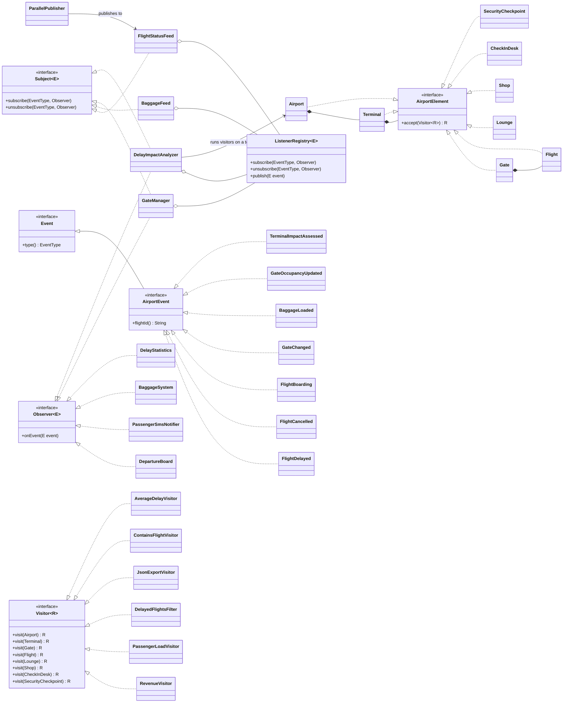

# Airport Operations: Observer + Visitor (Assignment 6, Variant 8)

Java 17, JUnit 5, no other libraries.

A flight-status feed and a baggage feed notify listeners (Observer). A stable tree
`Airport → Terminal → Gate → Flight` (with lounges, shops, check-in desks and security
checkpoints under terminals) gets new operations through visitors (Visitor). A delay event
runs visitors on the affected terminal only, and the result goes back into the system as a
new event.

## How to run

```
mvn test                                  # all 28 tests
java -Dproducer.threads=4 -cp target/classes airport.Main   # after mvn compile
```

`producer.threads` sets the number of producer threads in `Main` (default 3).

## UML class diagram



## Design decisions

### Observer

- **Push model.** An event is an immutable record that carries all its data (flight id, delay
  minutes, gates). Listeners never call back into the subject. With a pull model, the subject's
  state could change between the notification and the listener's read, which is a race when
  several producer threads publish. The cost of push is that an event may carry fields some
  listeners ignore.
- **Own generic interfaces.** `Subject<E>`, `Observer<E>` and `Event` (with an `EventType`).
  Listeners subscribe per event type and can join or leave at runtime, including from inside
  their own handler.
- **Thread-safe registry without locking the subject.** `ListenerRegistry` keeps a
  `ConcurrentHashMap<EventType, CopyOnWriteArrayList<Observer>>`. `publish` iterates over a
  snapshot, so subscribing or unsubscribing during publishing (even from inside a handler) is
  safe and never throws `ConcurrentModificationException`. The cost is that each subscribe or
  unsubscribe copies the list, which is acceptable because subscriptions change rarely and
  events are frequent.
- **Chain of observers.** `GateManager` listens to `GateChanged` and `FlightCancelled` and
  republishes `GateOccupancyUpdated`. `DelayImpactAnalyzer` listens to `FlightDelayed` and
  republishes `TerminalImpactAssessed`.

### Visitor

- **The visitor does the traversal, not the tree.** A container's `accept` only calls
  `visitor.visit(this)`; the visitor decides how to walk the children. Element classes hold
  data only. This lets one visitor run on any subtree (for example one terminal), which the
  integration step needs, and lets a visitor skip branches or collect state while walking.
  The cost is that every visitor repeats a small walking helper for the containers.
- **Double dispatch.** `element.accept(visitor)` selects the element's real type at runtime;
  inside it, `visitor.visit(this)` selects the matching overload at compile time. A client
  calling `visitor.visit(node)` directly would only see the static type (for example
  `AirportElement`) and could not pick the right overload.
- **Visitors.** `RevenueVisitor` (numeric), `PassengerLoadVisitor` (state across the whole
  tree, per-terminal totals), `DelayedFlightsFilter` (returns a list), `JsonExportVisitor`
  (hand-written nested JSON), plus `ContainsFlightVisitor` and `AverageDelayVisitor`.
  Stateful visitors are created per traversal and are not shared between threads.
- **Immutable tree.** Elements are records and containers copy their lists with
  `List.copyOf`, so the tree can be read from several threads safely.

### Integration

`FlightDelayed` → `DelayImpactAnalyzer` finds the terminal containing the flight with
`ContainsFlightVisitor`, runs `PassengerLoadVisitor` and `RevenueVisitor` on that terminal
only, and publishes `TerminalImpactAssessed(flightId, terminal, passengers, revenue)`.

### Concurrency

- `ParallelPublisher` runs producer batches on an `ExecutorService` with a configurable thread
  count (constructor argument; `-Dproducer.threads` in `Main`).
- `close()` calls `shutdown()` and `awaitTermination(30 s)`: all submitted batches finish, no
  event is lost, and no thread is left running. If the timeout is exceeded, it calls
  `shutdownNow()` and fails loudly.
- Shared state uses concurrent types: `ConcurrentHashMap` in listeners, `LongAdder` counters in
  `DelayStatistics`, and the copy-on-write registry.

### Clean Code

- One composition root (`Main`); constructor injection only; no lazy initialization of
  collaborators in business code.
- Every interface and class has a reason: two feeds because they publish different event
  families, two chained listeners because each turns one event into another.

### Known limitations

- Events from different producer threads can reach a listener in any order. Per-flight ordering
  is not guaranteed.
- `GateManager` publishes the "gate freed" and "gate occupied" events one after another, not
  atomically.

## Trade-off proof (two separate commits)

### Commit A: new visitor, no element class touched

Commit: `<paste hash from git log>` — "Add AverageDelayVisitor (new operation, no element class changed)"

| Files | Change |
| --- | --- |
| `visitors/AverageDelayVisitor.java` | new |
| `visitors/AverageDelayVisitorTest.java` (in `src/test`) | new |

Element classes and the `Visitor` / `AirportElement` interfaces: **0 files changed**.

**Cost: low.** A new operation is one new class. This is the case Visitor is designed for.

### Commit B: new element type

Commit: `<paste hash from git log>` — "Add SecurityCheckpoint element (requires updating Visitor and all visitors)"

| Files | Change |
| --- | --- |
| `model/SecurityCheckpoint.java` | new |
| `SecurityCheckpointTest.java` (in `src/test`) | new |
| `model/Visitor.java` | changed (new `visit` overload) |
| `RevenueVisitor`, `PassengerLoadVisitor`, `DelayedFlightsFilter`, `JsonExportVisitor`, `ContainsFlightVisitor`, `AverageDelayVisitor` | changed (6 files, each needs a new method) |

**Cost: high.** One new element touches the visitor interface and every existing visitor, and
the cost grows linearly with the number of visitors.

**When I would reject Visitor:** if new element types appear often while the set of operations
is stable. Then polymorphic methods on the elements are cheaper: a new type is one class,
while a new operation would touch every element. Visitor pays off in the opposite case,
which is this project: a stable tree where new operations are added (commit A).

## Tests

28 JUnit 5 tests.

| Test class | Tests | What it checks |
| --- | --- | --- |
| `ListenerRegistryTest` | 3 | per-type delivery, unsubscribe, unsubscribe inside a handler |
| `ListenersTest` | 6 | board, statistics, baggage, SMS text, gate chain |
| `VisitorsTest` | 7 | visitor results against hand-calculated values, JSON nesting and escaping |
| `DelayImpactAnalyzerTest` | 3 | visitors run on the right terminal only, unknown flight |
| `ParallelPublisherTest` | 3 | stress test 4 threads × 1,000 events = exactly 4,000, graceful close, unsubscribe while publishing |
| `AverageDelayVisitorTest` | 3 | commit A |
| `SecurityCheckpointTest` | 3 | commit B |
